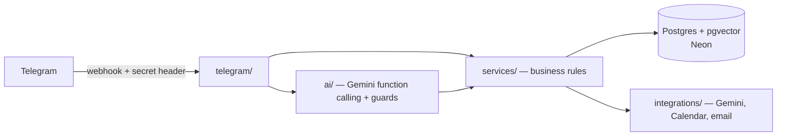

# AI BOaT

A Telegram assistant for a shared farmhouse: expense splitting between co-owners, a farm journal
with AI search (RAG), meetings, and reports — one Python service on Google Cloud Run with
Postgres (Neon).

It is the second version of a bot the owners use daily. Version 1 grew as a Node gateway plus a
Python AI service with Google Sheets as the database; this version rebuilds it as one service on a
real database. The reasons for each choice are in [docs/decisions.md](docs/decisions.md).

## Architecture



Layers only call downwards. `telegram/` never touches the database, and `services/` knows nothing
about Telegram, so another channel (WhatsApp, a web page) can reuse the services unchanged.

## Status

| Step | | |
|---|---|---|
| 1–3 | Accounts, structure, schema | ✅ |
| 4 | Core: webhook, access control, dedup, schema + migrations, CI | ✅ |
| 5 | Expenses: add, balance, settle, undo, search | next |
| 6 | Photo and voice | |
| 7 | Farm journal + RAG | |
| 8 | Meetings, PDF reports, email, scheduled jobs | |
| 9 | AI evals in CI | |
| 10 | Cloud Run deploy | |

## Access

Nobody can use the bot until approved. The admin (set by `ADMIN_TELEGRAM_ID`) is let in on
`/start`; anyone else who sends `/start` creates a request, and the admin gets **Owner / Guest /
Reject** buttons. Owners share expenses; guests can use every feature but are never part of the
split. Only the admin can approve people.

## Run it on your PC (Windows)

The bot talks to Telegram by **polling** when run locally, so no public URL or tunnel is needed.

```powershell
git clone https://github.com/tenalilogical-bit/ai-boat.git
cd ai-boat
python -m venv venv
venv\Scripts\activate
pip install -r requirements.txt
copy .env.example .env        # then fill in .env — use the Neon `test` branch URL
alembic upgrade head          # creates the tables
python -m scripts.dev_polling # message the bot in Telegram; Ctrl+C to stop
```

First run: leave `ADMIN_TELEGRAM_ID=0`, send `/start` — the bot replies with your Telegram ID.
Put it in `.env`, restart, send `/start` again.

## Running tests

Tests use a real Postgres with pgvector (never SQLite — the app relies on Postgres features).
`TEST_DATABASE_URL` must be a throwaway database: every table is emptied before each test.
GitHub Actions runs them on every push against its own Postgres container.

```powershell
$env:TEST_DATABASE_URL="postgresql://..."   # a scratch database, NOT the bot's
python -m pytest -q
```

## Layout

```
app/
  main.py           FastAPI app, /health
  config.py         settings from environment
  core/logging.py   JSON logs (Cloud Run severity + update_id on every line)
  db/               session.py (connection), models.py (tables)
  telegram/         webhook.py (entry point, routing), client.py (Bot API)
  services/         members.py (access requests, approval)
migrations/         Alembic schema versions
scripts/            dev_polling.py (local), set_webhook.py (after deploy)
tests/              pytest, real Postgres
docs/decisions.md   why things are the way they are
```
