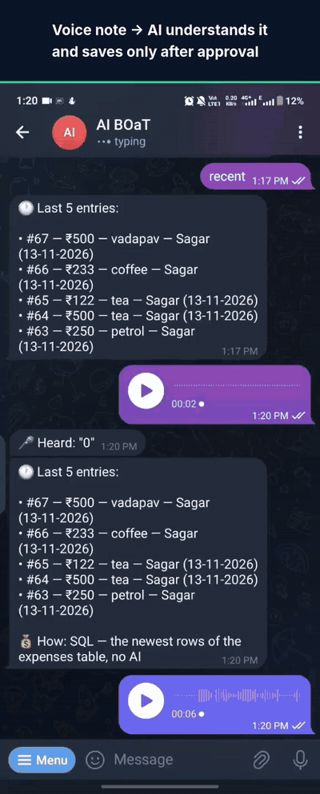
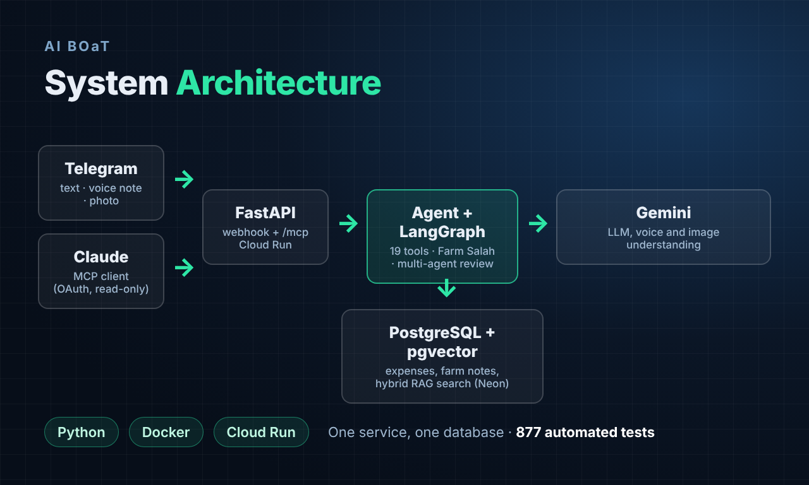
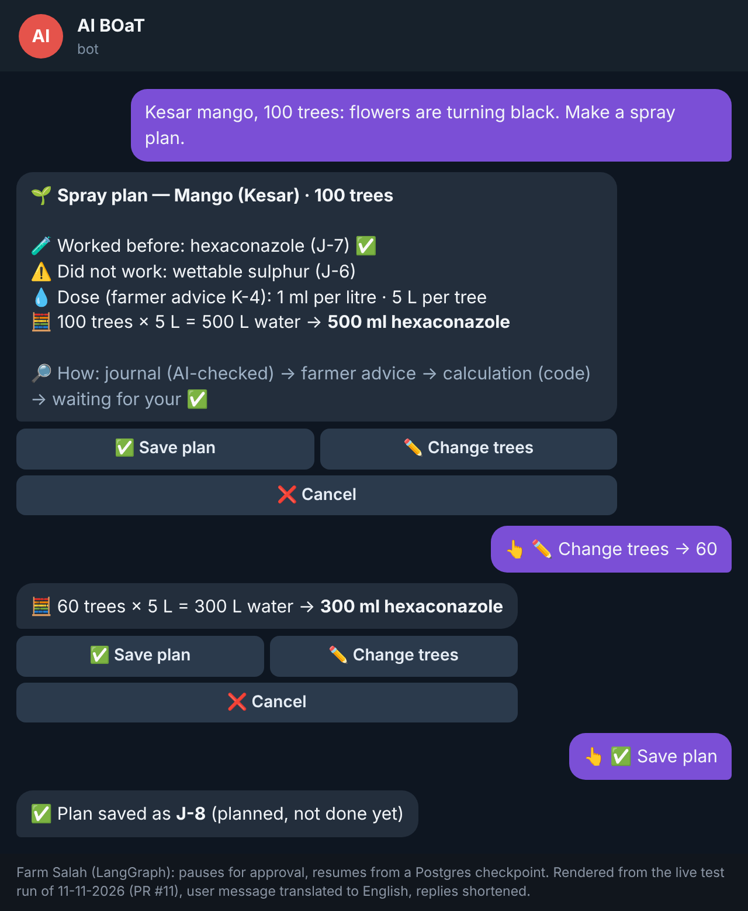
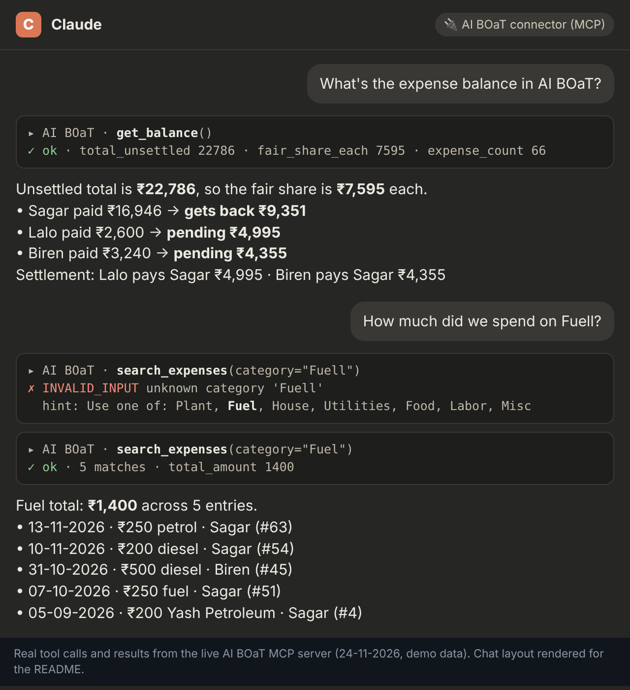
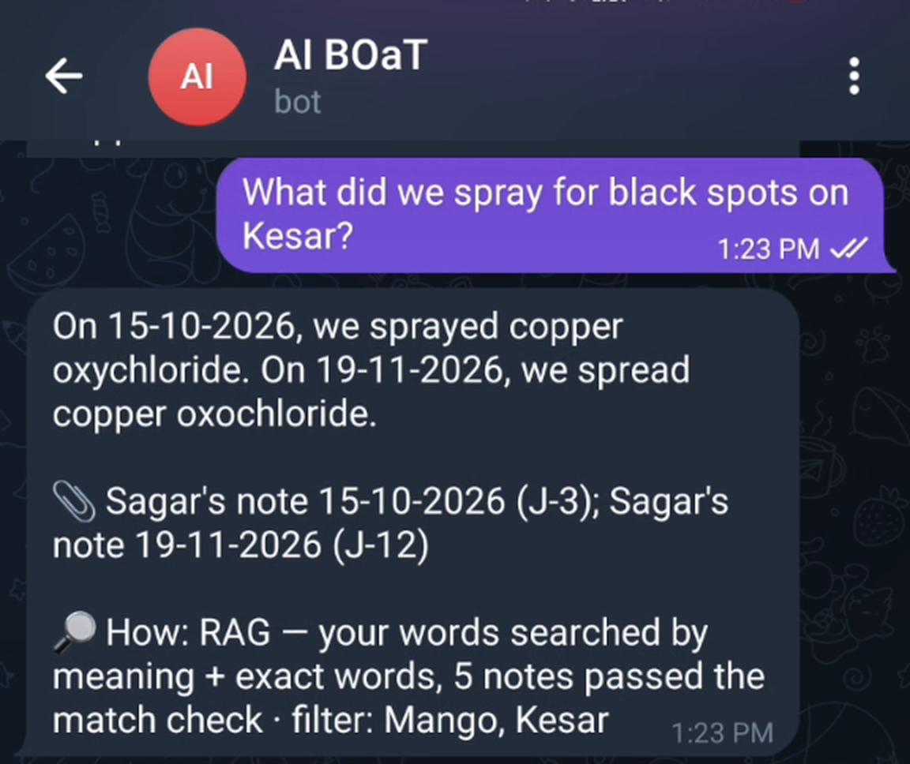
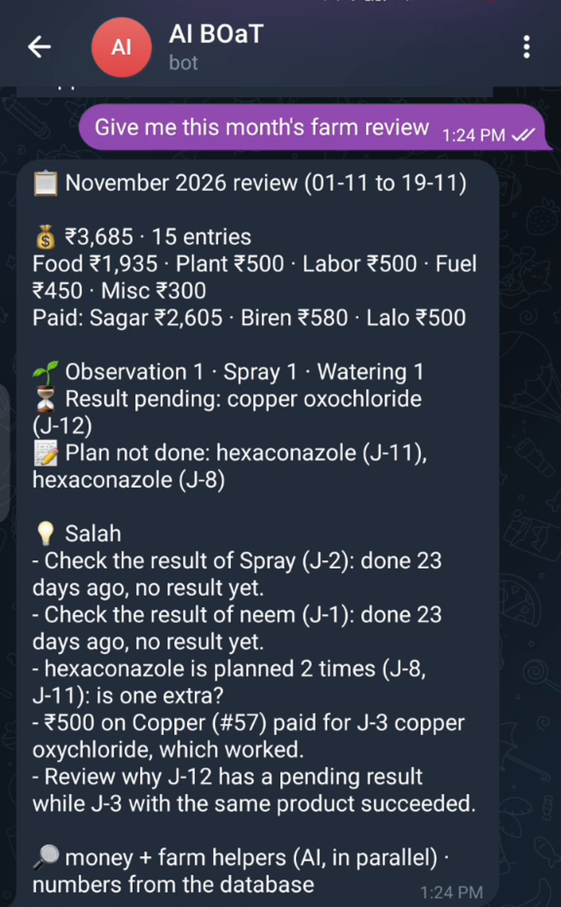
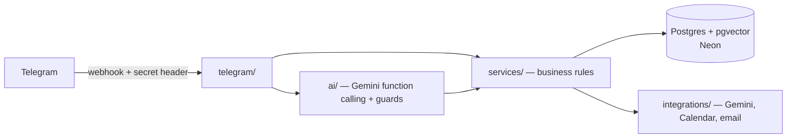
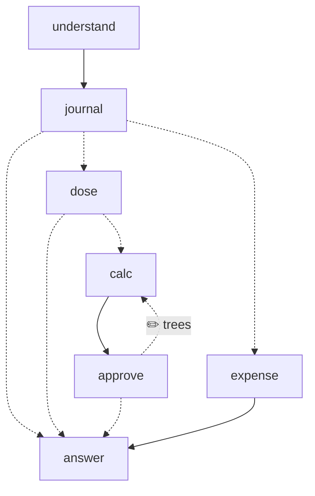
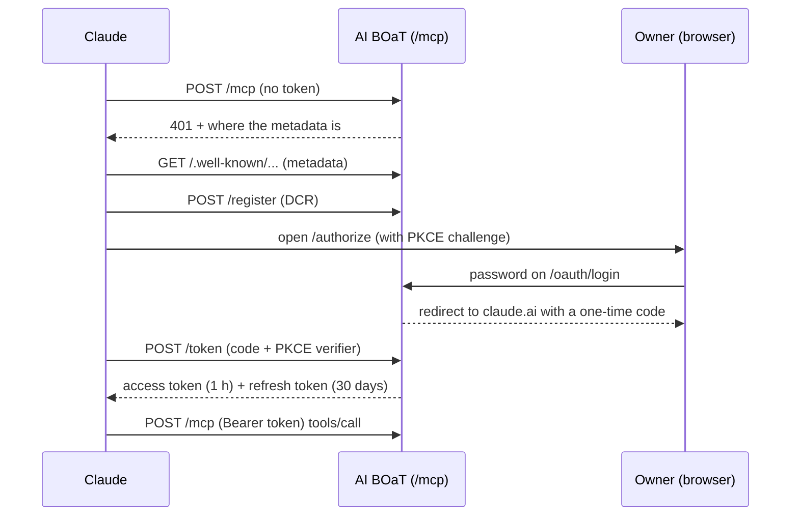

# AI BOaT

A Telegram assistant for a shared farmhouse: expense splitting between co-owners, a farm journal
with AI search (RAG), meetings, and reports — one Python service on Google Cloud Run with
Postgres (Neon).

It is the second version of a bot the owners use daily. Version 1 grew as a Node gateway plus a
Python AI service with Google Sheets as the database; this version rebuilds it as one service on a
real database. The reasons for each choice are in [docs/decisions.md](docs/decisions.md).

[](https://github.com/sagarshah-dev/ai-boat/actions/workflows/tests.yml)

## Demo

<p align="center">
  
</p>



| Farm Salah (LangGraph): pauses for approval before saving | MCP server: Claude reads the data (OAuth, read-only) |
|---|---|
|  |  |

| Hybrid RAG search with cited notes | Multi-agent monthly review |
|---|---|
|  |  |

## At a glance

| | |
|---|---|
| **What** | An AI agent in Telegram that records shared expenses, keeps a farm journal and answers questions in Gujarati and English, from text, voice notes and photos |
| **Users** | Version 1 is used daily by the 3 co-owners. This version is proven on test data and real-model evals before the users move over |
| **Stack** | Python 3.13, FastAPI, Gemini (function calling, embeddings), PostgreSQL + pgvector (Neon), LangGraph, MCP, Docker, Cloud Run, GitHub Actions |
| **Quality** | 877 automated tests on real Postgres on every push (also through PgBouncer) · 134 real-model eval cases · release gate: 0 wrong database writes |
| **Decisions** | 30 written design decisions, each with the reason and the trade-off: [docs/decisions.md](docs/decisions.md) |

## Highlights

- **The model chooses, code decides.** Gemini picks a tool; code checks every amount, payer, date
  and category before anything is written. Money in replies always comes from a template, never
  from the model's own words.
- **Propose, then confirm.** Anything read from a photo, voice note or loose text is shown first and
  saved only on ✅. Pending proposals live in the database, so a restart loses nothing.
- **Hybrid RAG over the farm journal.** Keyword and vector search (pgvector) together. Exact
  questions ("when did we last give humic?") are answered from table rows, not from search.
- **LangGraph with a human in the loop.** Farm Salah chains journal → dose → amount → approval, and
  waits up to 24 hours for ✅ with Postgres checkpoints.
- **Multi-agent review.** A supervisor runs a money agent and a farm agent in parallel for the
  monthly farm review.
- **MCP server.** Four read-only tools for Claude, behind an OAuth 2.1 server (DCR + PKCE) built
  into the app.
- **Evals that measure outcomes.** Real Gemini through the real webhook on a throwaway database;
  results are graded in code by the rows written, not by reading the reply.

## Architecture



Layers only call downwards. `telegram/` never touches the database, and `services/` knows nothing
about Telegram, so another channel (WhatsApp, a web page) can reuse the services unchanged.

## Status

| | | |
|---|---|---|
| Setup | Accounts, structure, schema, core (webhook, access, dedup, CI) | ✅ |
| Feature 1 | Expenses (typed): add, balance, settle, undo, recent, search, filters | ✅ |
| Feature 2 | Photo and voice expenses (preview, then yes) | ✅ |
| Feature 3 | PDF reports, email, settle snapshot, daily job | ✅ |
| Feature 4 | Meetings (Google Calendar, email invites) | ✅ |
| Feature 5 | Farm journal + RAG search, follow-ups, /menu | ✅ |
| Feature 6 | AI evals (real model) + production-like test run | ✅ |
| Feature 7 | Cloud Run deploy | ✅ (continuous, from `main`) |
| Feature 8 | 🌱 Farm Salah — LangGraph: plan with approval, journal → expense hand-offs | ✅ |
| Feature 9 | Short-term memory: last 3 exchanges per chat and member, corrections become edits | ✅ |
| Feature 10 | Farm review — multi-agent: LangGraph supervisor + money and farm helper agents | ✅ |
| Feature 11 | MCP server for Claude — 4 read-only tools, OAuth 2.1 (DCR + PKCE) | ✅ |

## Access

Nobody can use the bot until approved. The admin (set by `ADMIN_TELEGRAM_ID`) is let in on
`/start`; anyone else who sends `/start` creates a request, and the admin gets **Owner / Guest /
Reject** buttons. Owners share expenses; guests can use every feature but are never part of the
split. Only the admin can approve people.

## Using it

Type an expense in plain words — `150 tea by sagar`, `diesel 2k`, `2 lakh tractor` — or several
lines for several expenses. Ask in your own words: `hisab aapo`, `sagar no kharch aa mahine`.

| Command | |
|---|---|
| `balance` / `bal` | who is pending, who gets back, settle-up plan |
| `recent` | last 5 entries |
| `undo` | removes your own last unsettled entry |
| `sagar`, `fuel expenses` | every entry for a person or category, with total |
| `search ...` | `search diesel after 1 oct` |
| `settle` | asks for the PIN, then settles up (PDF snapshot + email) |
| `report [scope]` / `email [scope]` | PDF — `report fuel`, `report last month` |
| `menu` | buttons: farm note, ask the farm, plant count, this week, balance, meetings |
| `reindex` | rebuilds the farm search copy (normally done by the daily job) |

**Photos and voice.** A photo of a bill or khata, or a voice note, is read by the AI and shown
first; nothing is saved until **✅ Save**. A photo with a farm caption (`aamba na pan par daag`)
becomes a farm note instead. A long voice note (1 min+) is offered as the farmer's advice.

**Meetings.** `kale saanje 5 vagye meeting` — proposed, then booked on yes, with a Google
Calendar entry and an email invite. "5 vagye" with no morning/evening is asked, never guessed.

**Farm journal.** `aaje badha aamba ma neem spray, 50 ml, savare` is previewed with every field;
a missing dose or time is asked once. Exact questions (`humic chhelle kyare aapyu?`,
`ketla chhod che?`) are answered from the rows; experience questions (`pehla daag padya tyare shu
karyu?`) are searched by meaning and answered with the notes they came from. A treatment gets a
"how did it go?" after 7 days.

**🌱 Farm Salah (LangGraph).** For tasks where one answer feeds the next step:
`Kesar na 100 zhad par mor kala che. Spray plan banao.` → the treatment that worked (from the
journal results), the dose (from the farmer's advice), the amount (code), then **✅ Save plan /
✏️ Change trees / ❌ Cancel** — the plan waits 24 hours, only for the person who asked.
`...kai dava kaam kari, ane e dava chhelle kyare kharidi?` → the medicine, then its purchase.
`Je divase copper chhantyu, e divase biju kai kharch thayo?` → the date, then that day's
expenses. A saved plan is asked about 2 days later ("was it done?").



Money is never worded by the AI: every reply carrying an amount comes from a fixed template, and
an amount is saved only if it is written in the message (`tea by sagar` is asked, not guessed).

## MCP server (use the data from Claude)

`/mcp` exposes four **read-only** tools to Claude or any MCP client: `search_farm_notes`,
`last_farm_activity`, `search_expenses`, `get_balance`. Writing stays in the bot, behind ✅ and
the settle PIN. Sign-in is OAuth 2.1; Claude registers itself and the owner types
`MCP_OWNER_PASSWORD` on the sign-in page once. Off unless both settings are set:

| Variable | Value |
|---|---|
| `PUBLIC_BASE_URL` | the service URL, e.g. `https://ai-boat-xxxx.a.run.app` (no `/` at the end) |
| `MCP_OWNER_PASSWORD` | at least 12 characters, used only on the sign-in page |

Connect: Claude → Settings → Connectors → Add custom connector → name `AI BOaT`, URL
`<PUBLIC_BASE_URL>/mcp` → Add → Connect → type the password → Allow.



## Run it on your PC (Windows)

The bot talks to Telegram by **polling** when run locally, so no public URL or tunnel is needed.

```powershell
git clone https://github.com/sagarshah-dev/ai-boat.git
cd ai-boat
python -m venv venv
venv\Scripts\activate
pip install -r requirements.txt
copy .env.example .env        # then fill in .env — use the Neon `test` branch URL
alembic upgrade head          # creates the tables
python -m scripts.dev_polling # message the bot in Telegram; Ctrl+C to stop
```

First run: leave `ADMIN_TELEGRAM_ID=0`, send `/start` — the bot replies with your Telegram ID.
Put it in `.env`, restart, send `/start` again.

## Running tests

Tests use a real Postgres with pgvector (never SQLite — the app relies on Postgres features).
`TEST_DATABASE_URL` must be a throwaway database: every table is emptied before each test.
GitHub Actions runs them on every push against its own Postgres container.

```powershell
$env:TEST_DATABASE_URL="postgresql://..."   # a scratch database, NOT the bot's
python -m pytest -q
```

## Evals (real model)

`tests/` script the model. `evals/` run the REAL Gemini models through the real webhook on a
throwaway database, and grade outcomes in code. GitHub → Actions → **Evals** → Run workflow
(needs the `GEMINI_API_KEY` repository secret). The number that must stay 0 is "wrong writes".

## Layout

```
app/
  main.py           FastAPI app, /health
  config.py         settings from environment
  core/logging.py   JSON logs (Cloud Run severity + update_id on every line)
  db/               session.py (connection), models.py (tables)
  telegram/         webhook.py (entry, access), commands.py (command words, photo, voice,
                    buttons), farm_ui.py (menu, routing rules), client.py
  ai/               agent.py (model loop + gates), guards.py, tools.py, proposals.py
                    (preview -> yes), media.py (photo / voice), meeting_tools.py, farm_tools.py,
                    farm_salah.py (LangGraph: plan / hand-off tasks, Postgres checkpoints)
  services/         members, expenses, balance, settlements, pending, reports, mail,
                    meetings, farm (journal, plants, advice), rag_index, rag (search + answer)
  integrations/     gemini.py (retries, fallback, embeddings), email.py, calendar.py
  jobs/             routes.py (POST /jobs/daily), farm_jobs.py (follow-ups, plan reminders,
                    search sync, cleanup of abandoned plans)
  mcp/              server.py (MCP server, 4 tools, mount), tools.py (input checks, error
                    contract), auth_provider.py (OAuth 2.1 store), login.py (sign-in page)
migrations/         Alembic schema versions
scripts/            dev_polling.py (local), set_webhook.py (after deploy)
tests/              pytest, real Postgres
evals/              real-model evals (chat + farm RAG), run from GitHub Actions
docs/decisions.md   why things are the way they are
```

## How I built this

I built AI BOaT with AI-assisted development (Claude Code). I gathered the requirements from the
co-owners, chose the architecture, made every product decision (recorded in
[docs/decisions.md](docs/decisions.md)), reviewed each change, tested it live in Telegram and turned
every live bug into a test or eval case before the fix. Much of the code was written with Claude
Code, and every change is gated by the test suite and, for AI behaviour, the real-model evals.
